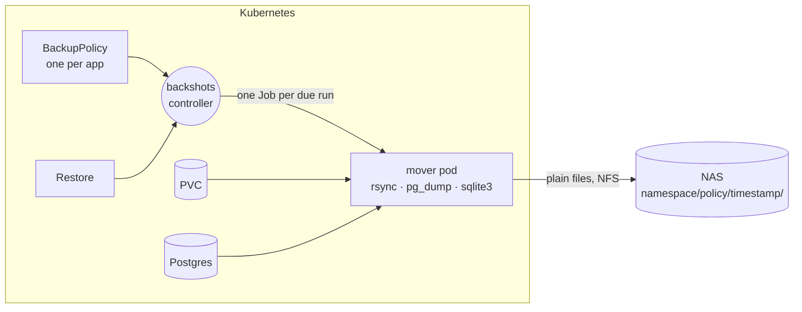

<p align="center">
  
</p>

<p align="center">
  <a href="https://github.com/willuhmjs/backshots/actions/workflows/ci.yaml"></a>
  <a href="LICENSE"></a>
  <a href="https://github.com/willuhmjs/backshots/releases"></a>
  
  
</p>

<p align="center">
  <b><a href="#quickstart">Quickstart</a></b> ·
  <a href="docs/REFERENCE.md">Reference</a> ·
  <a href="docs/RESTORE-RUNBOOKS.md">Restore runbooks</a> ·
  <a href="docs/DESIGN.md">Design</a> ·
  <a href="https://willuhmjs.github.io/backshots/">Website</a>
</p>

---

**backshots** is a small Kubernetes operator that backs up your volumes and databases to an NFS share as
**plain files**. No backup server, no object store, no encryption keys, no repository format. Every snapshot is a
normal folder you can open in Finder, Explorer or `cp -a`. If the operator, the cluster and this project all
disappeared tomorrow, your data would still be sitting in folders named after timestamps.

```text
nas:/k8s-backup/gitea/gitea-db/2026-11-22T10-00-00Z/postgres/gitea.sql.gz     <- zcat | psql
nas:/k8s-backup/gitea/gitea-data/2026-11-22T03-00-00Z/data/repositories/...   <- a normal directory tree
```

## Why you might want it

- **Restore by copying files.** That is the whole recovery story. The operator is a convenience, not a
  dependency, and there is no tool you must have working on the worst day of your year.
- **Databases done properly.** `pg_dump` and SQLite's online backup, not a hot copy of data files. The dump runs
  inside *your own* Postgres image, so the client always matches the server version.
- **A backup you have never restored is a guess.** Set a `verify` schedule and backshots restores the latest
  snapshot into a scratch database and runs your SQL assertions. The result is on the policy:
  `VERIFIED true`.
- **Built for homelabs and small clusters.** One small controller. Hardlink snapshots keep history cheap, and
  retention (hourly, daily, weekly, monthly) is built in.
- **Safe by default.** An empty or shrunken volume never overwrites a good history. A snapshot only appears
  once it is complete. Restores validate everything *before* stopping your app, and undo themselves if you
  delete them halfway.

## Quickstart

You need Kubernetes 1.29+, an NFS export your nodes can write to as root (`no_root_squash`, because backups
preserve ownership) and an NFS client on the nodes.

```sh
helm repo add backshots https://willuhmjs.github.io/backshots
helm repo update
helm install backshots backshots/backshots -n backshots-system --create-namespace \
  --set store.create=true \
  --set store.nfs.server=192.168.1.5 \
  --set store.nfs.path=/volume1/k8s-backup
```

Then put a `BackupPolicy` next to each thing you want protected:

```yaml
apiVersion: backshots.io/v1alpha1
kind: BackupPolicy
metadata: {name: gitea-db, namespace: gitea}
spec:
  storeRef: default
  schedule: "0 * * * *"                  # hourly
  source:
    type: postgres
    postgres:
      image: postgres:16                 # pg_dump always matches your server
      host: postgres.gitea.svc
      passwordSecretRef: {name: postgres, key: password}
  verify:                                # prove it restores
    schedule: "0 4 * * 0"
    database: gitea
    sql: ["select count(*) > 100 from repository"]
---
apiVersion: backshots.io/v1alpha1
kind: BackupPolicy
metadata: {name: gitea-data, namespace: gitea}
spec:
  storeRef: default
  schedule: "0 3 * * *"
  source:
    type: files
    files: {pvc: gitea-data, exclude: ["*.tmp", "cache/"]}
```

```console
$ kubectl get backuppolicies -A          # example output
NAMESPACE   NAME         TYPE       SCHEDULE    LAST   SNAPSHOTS   VERIFIED   HEALTHY
gitea       gitea-db     postgres   0 * * * *   4m     26          true       True
gitea       gitea-data   files      0 3 * * *   9h     14          true       True
```

Want a backup *now*? Set `spec.trigger.manual: "now-1"` and it runs once. More in [`examples/`](examples).

Sources: **files** (rsync, preserving ownership, ACLs, xattrs and symlinks), **sqlite** (online backup plus an
integrity check) and **postgres** (per-database plain SQL plus roles).

## Restore

```yaml
apiVersion: backshots.io/v1alpha1
kind: Restore
metadata: {name: gitea-db-oops, namespace: gitea}
spec:
  policyRef: gitea-db
  from: latest                           # or a snapshot name, e.g. 2026-11-22T10-00-00Z
  databases: [gitea]
  scaleDown: [{kind: Deployment, name: gitea}]   # stopped first, started again afterwards
```

```console
$ kubectl get restores -n gitea          # example output
NAME             POLICY     FROM                   PHASE       MESSAGE
gitea-db-oops    gitea-db   2026-11-22T10-00-00Z   Succeeded
```

Before it touches anything it checks `from`, paths, database names and that the PVCs exist, and fails with a
message while your app is still running. Restores of one policy queue. If your workload will not stop, it gives
up and starts it again. Delete the `Restore` mid-flight and your workloads come back. Flux is told not to fight
it. A files restore can be one directory (`paths:`), or into a different PVC (`targetPVC:`).

**Or skip all of that** and copy files, which is the point:

```sh
# one file
cp -a /mnt/nas/gitea/gitea-data/2026-11-22T03-00-00Z/data/repositories/me/app.git/config ./
# a database
zcat /mnt/nas/gitea/gitea-db/2026-11-22T10-00-00Z/postgres/gitea.sql.gz | psql -d postgres
```

Step-by-step procedures for a file, a directory, a SQLite database, a Postgres database, a whole PVC and a whole
cluster rebuild are in [`docs/RESTORE-RUNBOOKS.md`](docs/RESTORE-RUNBOOKS.md).

## How it works



- The controller schedules runs itself and creates one Job per due run. Each mover pod mounts *only its own
  policy's folder* of the share, and your PVC. Nothing else is visible to it.
- A run builds `.incomplete-<time>/`, then renames it to `<time>/` in one atomic step. Files are hardlinked to the
  previous snapshot, so unchanged data costs nothing. Retention then prunes by hourly, daily, weekly and monthly
  counts.
- Status flows back through the pod's termination message: `kubectl get bp` shows the last snapshot, its size, the
  next run, whether it verified, and a `Healthy` condition that also turns false when a backup is *overdue*, which
  is what an unreachable NAS looks like.
- Kubernetes Events and Prometheus metrics (`backshots_policy_healthy`, last success, snapshot size, last verify)
  are there for alerting.

The longer version, with every behaviour and its limits, is in [`docs/REFERENCE.md`](docs/REFERENCE.md).

## Compared to other tools

| | backshots | VolSync | k8up | Velero |
|---|---|---|---|---|
| Backup format | plain files you can browse | restic or rclone repository | restic repository | Kopia/restic repository |
| Needs an object store | no, an NFS share | restic/S3 or similar | S3 or similar | yes, S3-compatible |
| Readable without the tool | yes | no | no | no |
| Database-consistent dumps | built in (Postgres, SQLite) | bring your own hook | pre-backup command | hooks |
| Built-in restore testing | yes (`verify`) | no | no | no |
| Backs up Kubernetes objects | no, use GitOps | no | no | yes, its main job |
| Encryption | none, by design | yes | yes | yes |
| Maturity | **alpha** | mature | mature | very mature |

Velero is the right answer when you must move whole clusters and namespaces around. VolSync and k8up are the
right answer when you want deduplicated, encrypted, off-site repositories. backshots is for when you want your
backups to be boring folders on a box you own.

## Status: alpha, and honest about it

backshots is new. The API is `v1alpha1` and may change. What exists today:

- A scripted end-to-end test ([`scripts/e2e.sh`](scripts/e2e.sh)) that builds a kind cluster and a real NFS
  server, installs the chart and checks backups, retention, verify, restores, the restore safety nets and
  authenticated metrics. It needs Docker, kind, kubectl and Helm.
- Unit tests for the retention logic, the runner and the controllers.
- Two independent reviews (functionality and security) whose findings were fixed or documented.

What is **not** proven yet: real Synology hardware, large volumes, long-running soak tests, Postgres versions other
than 16. Use it alongside, not instead of, your existing backups until you have run your own restore drill.
Known limits are listed in [`docs/REFERENCE.md`](docs/REFERENCE.md#limitations); the security model is in
[`SECURITY.md`](SECURITY.md).

## FAQ

**Why NFS?** It is the one protocol where hardlinks, ownership and symlinks work, and nearly every NAS speaks it.
SMB loses ownership and symlinks; object stores have neither.

**Why not encrypt?** No keys to lose on the worst day, and the backups stay readable by anything. The tradeoff:
whoever can read the share can read your data, so lock the export down to your nodes. If you need encryption at
rest, encrypt the volume on the NAS.

**What if the operator is down?** Scheduled runs pause until it is back (it then runs a missed slot once), and
the policy turns `Healthy=False/Stale` if too long passes. Your existing snapshots are untouched and restorable by
hand.

**Does it back up my Deployments, Secrets and CRDs?** No. Keep those in git (Flux, Argo CD) and back up the
*data* here.

**MySQL, MongoDB, ...?** Not yet. See below.

## Ideas, not promises

A generic "run this command and keep its output" source for MySQL, MongoDB and friends. Checksum manifests so
snapshots can be audited. A second copy to another share. Pull requests and issues are welcome, see
[CONTRIBUTING.md](CONTRIBUTING.md).

## Development

```sh
make build test lint          # build, unit tests, vet
make manifests                # regenerate CRDs after changing api/
scripts/e2e.sh                # the full end-to-end test (Docker, kind, kubectl, Helm)
```

## License

Apache-2.0, see [LICENSE](LICENSE).
