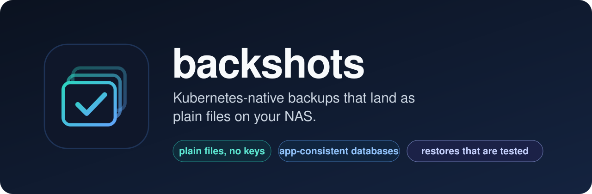
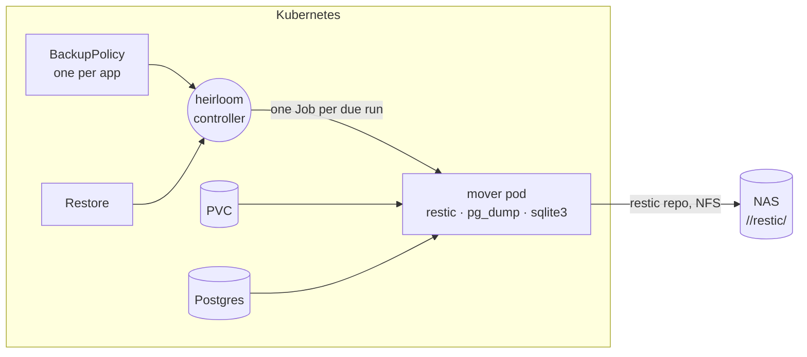

<p align="center">
  
</p>

<p align="center">
  <a href="https://github.com/willuhmjs/heirloom/actions/workflows/ci.yaml"></a>
  <a href="LICENSE"></a>
  <a href="https://github.com/willuhmjs/heirloom/releases"></a>
  
  
</p>

<p align="center">
  <b><a href="#quickstart">Quickstart</a></b> ·
  <a href="docs/REFERENCE.md">Reference</a> ·
  <a href="docs/RESTORE-RUNBOOKS.md">Restore runbooks</a> ·
  <a href="docs/DESIGN.md">Design</a> ·
  <a href="https://willuhmjs.github.io/heirloom/">Website</a>
</p>

---

**heirloom** is a small Kubernetes operator that backs up your volumes and databases onto one NFS export as
**restic repositories**. No backup server, no object store, nothing listening on a port — just a plain local restic
repository per policy on your share. Because every run is **deduplicated**, a changed 10 GiB file costs its changed
chunks (a few MiB), not a fresh 10 GiB copy; sqlite copies and postgres dumps dedup across runs too. History gets
dramatically cheaper, so retention can stay generous.

```text
nas:/k8s-backup/gitea/gitea-data/restic/     <- a restic repository (plain local backend)
nas:/k8s-backup/gitea/gitea-db/restic/       <- the same, for the database
```

The repositories are unencrypted and passwordless (`restic --insecure-no-password`) on purpose: no password to lose
on the worst day of the year. The NFS export's ACL remains the security boundary, same as before.

## Why you might want it

- **Deduplicated history.** Each run stores only the chunks that changed, so a year of hourly backups costs a
  fraction of the bytes it used to. The policy's status reports the bytes actually *added* after dedup, so you can
  watch it working.
- **Databases done properly.** `pg_dump` and SQLite's online backup, not a hot copy of data files. The dump runs
  inside *your own* Postgres image, so the client always matches the server version. Anything else with a CLI dump
  tool (MySQL, MongoDB, Redis) fits the `command` source: it `exec`'s your command in the app's pod and keeps its
  output, with pre/post hooks to take and release a lock.
- **A backup you have never restored is a guess.** Set a `verify` schedule and heirloom restores the latest
  snapshot into a scratch database and runs your SQL assertions. The result is on the policy:
  `VERIFIED true`.
- **Built for homelabs and small clusters.** One small controller, and the repository is a plain local restic repo
  on your own export — no rest-server, no object storage, no service to run. Retention (hourly, daily, weekly,
  monthly) is built in.
- **Safe by default.** An empty or shrunken volume never overwrites a good history — a snapshot the guard rejects
  is forgotten, so `latest` stays the last complete one. Restores validate everything
  *before* stopping your app, wait for any backup in flight, pause autoscalers aimed at what they stop, and undo
  themselves if you delete them halfway.

## Quickstart

You need Kubernetes 1.29+, an NFS export your nodes can write to as root (`no_root_squash`, because backups
preserve ownership) and an NFS client on the nodes.

```sh
helm repo add heirloom https://willuhmjs.github.io/heirloom
helm repo update
helm install heirloom heirloom/heirloom -n heirloom-system --create-namespace \
  --set store.create=true \
  --set store.nfs.server=192.168.1.5 \
  --set store.nfs.path=/volume1/k8s-backup
```

Then put a `BackupPolicy` next to each thing you want protected:

```yaml
apiVersion: heirloom.io/v1
kind: BackupPolicy
metadata: {name: gitea-db, namespace: gitea}
spec:
  storeRef: default
  schedule: "0 * * * *"                  # hourly
  source:
    type: postgres
    postgres:
      image: postgres:16                 # pg_dump always matches your server
      host: postgres.gitea.svc
      passwordSecretRef: {name: postgres, key: password}
  verify:                                # prove it restores
    schedule: "0 4 * * 0"
    database: gitea
    sql: ["select count(*) > 100 from repository"]
---
apiVersion: heirloom.io/v1
kind: BackupPolicy
metadata: {name: gitea-data, namespace: gitea}
spec:
  storeRef: default
  schedule: "0 3 * * *"
  source:
    type: files
    files: {pvc: gitea-data, exclude: ["*.tmp", "cache/"]}
```

```console
$ kubectl get backuppolicies -A          # example output
NAMESPACE   NAME         TYPE       SCHEDULE    LAST   SNAPSHOTS   VERIFIED   HEALTHY
gitea       gitea-db     postgres   0 * * * *   4m     26          true       True
gitea       gitea-data   files      0 3 * * *   9h     14          true       True
```

Want a backup *now*? Set `spec.trigger.manual: "now-1"` and it runs once. More in [`examples/`](examples).

Sources: **files** (`restic backup` from the volume root, subPath and excludes honored), **sqlite** (online backup
plus an integrity check), **postgres** (`pg_dump` per database plus `pg_dumpall` globals) and **command** (any
dump command `exec`'d in your app's pod — MySQL, MongoDB, Redis — with optional pre/post quiesce hooks).

## Restore

```yaml
apiVersion: heirloom.io/v1
kind: Restore
metadata: {name: gitea-db-oops, namespace: gitea}
spec:
  policyRef: gitea-db
  from: latest                           # or a restic snapshot hex id, e.g. 4a1c9f2e
  databases: [gitea]
  scaleDown: [{kind: Deployment, name: gitea}]   # stopped first, started again afterwards
```

```console
$ kubectl get restores -n gitea          # example output
NAME             POLICY     FROM       PHASE       MESSAGE
gitea-db-oops    gitea-db   4a1c9f2e   Succeeded
```

Before it touches anything it checks `from`, paths, database names and that the PVCs exist, and fails with a
message while your app is still running. Restores of one policy queue. If your workload will not stop, it gives
up and starts it again. Delete the `Restore` mid-flight and your workloads come back. Flux is told not to fight
it. Restores write straight back onto the volume (subPath-aware) via restic's `--include`; a files restore can be
one directory (`paths:`), or into a different PVC (`targetPVC:`). `delete:` maps to `restic restore --delete` and
carries the backup's exclude patterns so excluded files are never removed — `delete` together with `paths` is
rejected, because restic cannot mix include and exclude.

**Getting at the store by hand.** The store is not browsable: snapshots live inside restic's pack format, so there
are no timestamp folders to open in Finder and nothing to `cp -a`. This is the price of dedup — you trade folders
you can eyeball for history that costs a fraction of the disk. For day-to-day recovery you create a `Restore` CR.
To pull data manually, use the restic binary that ships in the mover image:

```sh
restic -r /mnt/nas/gitea/gitea-data/restic --insecure-no-password restore latest --target ./recovered
# also: snapshots, ls, and dump to read a single file
```

Step-by-step procedures for a file, a directory, a SQLite database, a Postgres database, a whole PVC and a whole
cluster rebuild are in [`docs/RESTORE-RUNBOOKS.md`](docs/RESTORE-RUNBOOKS.md).

## How it works



- The controller schedules runs itself and creates one Job per due run. Each mover pod mounts *only its own
  `<namespace>/<policy>` folder* of the export, its PVC, and a `/scratch` volume for restic's cache and staging.
  Nothing else is visible to it.
- A run commits into the policy's restic repository: files are added with `restic backup` from the volume root, and
  sqlite copies and postgres dumps are staged in a transient `.staging/` folder then committed. Retention runs
  `restic forget --keep-hourly/.../weekly/monthly --prune`, and the policy's `Healthy` message reports snapshots
  kept and pruned and the bytes actually **added** after dedup.
- `verify` runs `restic check` plus a rotating read of pack data (`--read-data-subset=N/10`, so the whole
  repository is read within ten weeks), then per source: files are restored and checksum-compared against
  `restic dump`; every sqlite database gets `PRAGMA integrity_check`; postgres dumps are loaded into a throwaway
  Postgres on scratch and your `verify.sql` assertions run against them.
- Status flows back through the pod's termination message: `kubectl get bp` shows the last snapshot (restic's
  short hex id), the bytes it added, the next run, whether it verified, and a `Healthy` condition that also turns
  false when a backup is *overdue*, which is what an unreachable NAS looks like.
- Kubernetes Events and Prometheus metrics (`heirloom_policy_healthy`, last success, snapshot size, last verify)
  are there for alerting.
- The runner image ships restic 0.18.1, built from the pinned tag with `CGO_ENABLED=0` so the same static
  binary also runs inside the postgres mover image, and the Dockerfile fails the build if
  restic cannot init a repository, so the pinned feature set is enforced at build time. For sqlite and postgres
  verify and restore, `/scratch` must be big enough to hold the restored payloads — set
  `pod.scratchStorageClassName` for large databases.

The longer version, with every behaviour and its limits, is in [`docs/REFERENCE.md`](docs/REFERENCE.md).

## Upgrading from an earlier build

Policies keep working and keep their schedules; the next backup simply creates the policy's restic repository. The
old plain hardlinked snapshot folders are left untouched but are no longer read or written, so you can delete them
once you no longer need them. Backups are restic now, always — there is no toggle.

## Compared to other tools

| | heirloom | VolSync | k8up | Velero |
|---|---|---|---|---|
| Backup format | restic repository on NFS (local backend) | restic or rclone repository | restic repository | Kopia/restic repository |
| Needs an object store or server | no, an NFS share | restic/S3 or similar | S3 or similar | yes, S3-compatible |
| Readable without the tool | no — needs the restic binary | no | no | no |
| Database-consistent dumps | built in (Postgres, SQLite) + any `exec`'d dump command | bring your own hook | pre-backup command | hooks |
| Built-in restore testing | yes (`verify`) | no | no | no |
| Backs up Kubernetes objects | no, use GitOps | no | no | yes, its main job |
| Encryption | none, by design | yes | yes | yes |
| Maturity | **v1.0, but new** | mature | mature | very mature |

Velero is the right answer when you must move whole clusters and namespaces around. VolSync and k8up are the right
answer when you want encrypted, off-site repositories in object storage. heirloom is for when you want
deduplicated restic repositories on a box you own, with no service to run.

## Status: 1.0, and honest about it

The API is `v1` and follows semver: fields are added in minor releases, never removed or redefined outside a
major one. What exists today:

- A scripted end-to-end test ([`scripts/e2e.sh`](scripts/e2e.sh)) that builds a kind cluster and a real NFS
  server, installs the chart and checks backups, retention, verify, restores, the restore safety nets and
  authenticated metrics. It needs Docker, kind, kubectl and Helm.
- Unit tests for the retention logic, the runner and the controllers.
- Two independent reviews (functionality and security) whose findings were fixed or documented.

What is **not** proven yet: real Synology hardware, large volumes, long-running soak tests, Postgres versions other
than 16. Use it alongside, not instead of, your existing backups until you have run your own restore drill.
Known limits are listed in [`docs/REFERENCE.md`](docs/REFERENCE.md#limitations); the security model is in
[`SECURITY.md`](SECURITY.md).

## FAQ

**Why NFS?** It is the one protocol that nearly every NAS speaks and that restic can write to directly as a local
backend, with ownership and symlinks intact. SMB loses ownership and symlinks; object stores have neither.

**Why not encrypt?** No password to lose on the worst day, and no key to misplace when you need the data most. The
tradeoff: whoever can read the share can read your data, so lock the export down to your nodes. If you need
encryption at rest, encrypt the volume on the NAS.

**What if the operator is down?** Scheduled runs pause until it is back (it then runs a missed slot once), and the
policy turns `Healthy=False/Stale` if too long passes. Your existing snapshots are untouched and restorable by hand
with the restic binary.

**Does it back up my Deployments, Secrets and CRDs?** No. Keep those in git (Flux, Argo CD) and back up the
*data* here.

**MySQL, MongoDB, ...?** Yes. The `command` source `exec`'s your dump tool (`mysqldump`, `mongodump`,
`redis-cli`) in the app's own pod and stores its output; a restore writes the dumps onto a PVC for the app's
import tool to load. It is not as integrated as the Postgres path (no dump-into-a-scratch-server verify), but
the data is backed up and restorable.

## Ideas, not promises

A second copy to another
share. Pull requests and issues are welcome, see [CONTRIBUTING.md](CONTRIBUTING.md).

## Development

```sh
make build test lint          # build, unit tests, vet
make manifests                # regenerate CRDs after changing api/
scripts/e2e.sh                # the full end-to-end test (Docker, kind, kubectl, Helm)
```

## License

Apache-2.0, see [LICENSE](LICENSE).
